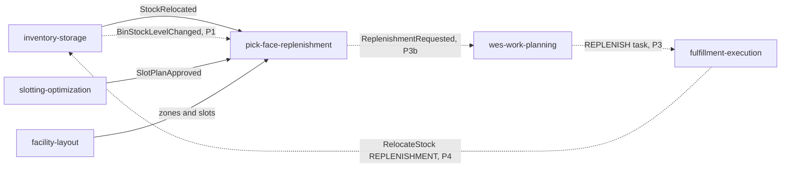

# ADR 0001: pick-face-replenishment as the owner of forward pick-face replenishment

## Status

Accepted (2026-10-17).

## Context

`slotting-optimization` decides which SKU holds which forward pick slot and
publishes the approved map. `inventory-storage` owns the stock ledger and can
relocate stock between bins. `fulfillment-execution` runs the floor tasks.
Nothing watches whether a forward pick face still holds enough of its SKU, and
nothing asks for stock to be moved from a reserve bin when it runs low. The
slotting context page lists "REPLENISH (min/max) work" as planned, not built.
Today a picker finds an empty face and the problem is solved by hand.

Replenishment is a stock-level-driven work generator: it reacts to levels,
holds a policy per pick face, and ends when the ledger records the move. That
lifecycle differs from slotting (which plans slots and never watches levels)
and from `fulfillment-execution` (which owns task state and must stay the
single writer of it), so it is a context of its own.

## Decision

Introduce `pick-face-replenishment` as a new bounded context. It owns the
**ReplenishmentPolicy** (explicit min/max per site and SKU) and the
**ReplenishmentRequest** (one decision to move stock from one reserve bin to one
forward bin, and how it ended). It never creates floor work itself and never
writes the ledger.

### Bounded context canvas

| Field | Value |
|---|---|
| Name | pick-face-replenishment |
| Purpose | Keep every forward pick face stocked between its minimum and maximum by requesting a move from the best reserve bin, and close the request when the ledger records the move. |
| Strategic classification | **Supporting subdomain**. Necessary for picking without stock-outs, but min/max and source-bin choice are replaceable policy objects, not the competitive core; the WES conductor (`wes-work-planning`) and the task lifecycle (`fulfillment-execution`) stay Core. |
| Tier / CloudEvents subdomain | **WMS**, subdomain `wms`: the sixth `wms` context, next to `slotting-optimization`, which it extends (the other half of the forward-pick model). Type prefix `com.warehouse.wms.pick-face-replenishment.`, source `/warehouse/pick-face-replenishment`. |
| Domain roles | Policy holder (min/max), work generator (requests), closer (completion from the ledger event). |
| Inbound communication | Events from `inventory-storage`, `slotting-optimization`, `facility-layout` (ADR 0003); REST commands from planners (policies, manual request, cancel, evaluate). |
| Outbound communication | `ReplenishmentRequested`, `ReplenishmentCompleted`, `ReplenishmentCancelled` on `warehouse.pick-face-replenishment.events`, plus the analytics topic (ADR 0004); REST reads for operators, the console and agents. |
| Ubiquitous language | Pick face, forward bin, reserve bin, policy (min, max, multiple), request, projected level (on hand minus reserved plus open inbound), priority (NORMAL, URGENT), source bin policy, usable stock. |
| Business decisions | When a face is low (projected at or below min); how much (up to max, rounded down to a multiple); which reserve bin (fullest usable stock, ADR 0002); URGENT when nothing is available; when a request is cancelled. |
| Assumptions | Reserve bins are `Storage` locations in zones listed in `RESERVE_ZONE_CODES` (default `RSV`, the convention of slotting's `FORWARD_ZONE_CODES` default `FWD`); one SKU per forward slot; the forward bin of a SKU is its slot in the last approved slot plan. |
| Verification | Deterministic detector (same input in any slice order gives the same outcome), mutation gate over every domain package, golden tests per published type. |

### The model (v1)

Two aggregates and one pure detector: `ReplenishmentPolicy` (package `policy`),
`ReplenishmentRequest` (package `replenishment`, the richest aggregate) and the
`detection` package with the `SourceBinPolicy` port. Details and invariants are
ADR 0002. v1 ships only the explicit **MIN_MAX** policy; a demand-cover policy
(days of cover from `SiteSkuDemandChanged`) is a planned policy version behind
the same port.

### Context map

| Edge | Relationship | Status |
|---|---|---|
| inventory-storage -> pick-face-replenishment | Published Language (`BinStockLevelChanged`, `StockRelocated`, topic `warehouse.inventory.events`); pick-face-replenishment is a **Conformist** and keeps a local bin stock copy | `StockRelocated` verified on `origin/develop` 2026-10-17 (reason `REPLENISHMENT` is a new additive value); `BinStockLevelChanged` pinned consumer-first |
| slotting-optimization -> pick-face-replenishment | Published Language (`SlotPlanApproved`); **Conformist**, local forward-assignment copy | Contract verified 2026-10-17 |
| facility-layout -> pick-face-replenishment | Open Host Service / Published Language (`ZoneRegistered`, `LocationSlotRegistered`, `LocationSlotDecommissioned`); **Conformist**, local location copy | Contract verified 2026-10-17 |
| pick-face-replenishment -> warehouse-ops-agent, warehouse-console | **Open Host Service** (REST) | REST contract in `apis/openapi.yaml`; consumers are later phases |
| pick-face-replenishment -> wes-work-planning | Published Language (`ReplenishmentRequested`); wes-work-planning is the **Conformist** and turns it into a `REPLENISH` work unit | **PLANNED, not built** (producer-side change P3b) |
| wes-work-planning -> fulfillment-execution | `WorkReleased` carries an additive `replenishment` object and creates a `REPLENISH` task | **PLANNED, not built** (P3) |
| fulfillment-execution -> inventory-storage | `TaskCompleted` for a REPLENISH task becomes `RelocateStock` with reason `REPLENISHMENT` and `source_ref` = the request id | **PLANNED, not built** (P4) |
| inventory-storage -> pick-face-replenishment | `StockRelocated` with reason `REPLENISHMENT` closes the request | Consumer built in the service phase; the reason value arrives with P4 |

The four PLANNED edges plus the `BinStockLevelChanged` producer change (P1)
form the execution chain: pick-face-replenishment -> wes-work-planning ->
fulfillment-execution -> inventory-storage -> back to pick-face-replenishment.
It is the shape ADR 0010 of slotting-optimization proved for RELOCATE.

Solid edges are verified contracts; dashed edges are planned and not built.

### Exclusions

- **No live call to any sibling, in either direction.** pick-face-replenishment
  has no outbound HTTP client and no MCP client; siblings read its Kafka topic.
- **It never writes the stock ledger.** It requests a move; `inventory-storage`
  records it.
- **It never creates floor tasks.** `wes-work-planning` and
  `fulfillment-execution` own work and task state.
- **No edge to `inbound-receiving`, `order-management` or `product-master` in
  v1.**
- Out of scope for v1 (later ADRs): demand-cover and velocity-derived min/max,
  multi-SKU faces, reserve-to-reserve consolidation, travel-aware source choice.

## Consequences

- A new deployable (API, Postgres database, Kafka topic, Kong route
  `/api/pick-face-replenishment`) joins the fleet; `warehouse-infra` wires it in
  the wiring wave.
- The fleet CloudEvents rule that lists the `wms` contexts and the warehouse-docs
  subdomain table gain a row for this context; that change travels in the docs
  wave, not in this repo.
- Detection is only as good as the local copies feeding it. With no level, no
  assignment or no reserve location copy the detector reports `NO_SOURCE` or
  `NO_POLICY` instead of guessing.
- Nothing moves on the floor until the planned execution chain exists; until
  then requests open and can be cancelled but not completed.
