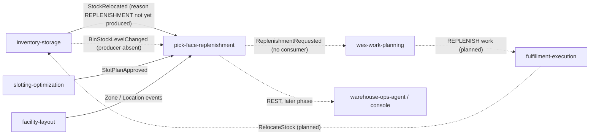

# Integration

Every upstream and downstream of `pick-face-replenishment`: protocol, contract and failure behaviour. Producer status was
checked against each sibling's `origin/develop` (`apis/asyncapi.yaml`, `apis/openapi.yaml`, code) on 2026-10-17.

**Fleet rules that shape this page.** The service makes **no outbound HTTP or MCP call** to any context: the module
imports `net/http` only for its own server, and cross-context data is event-fed local copies (ADR 0003). REST is
unauthenticated, and there is no MCP binary. Kafka is the single broker of the platform; every message is a CloudEvents
1.0 structured-mode event.

## Upstream and downstream edges

| Edge | Protocol | Contract | Status today |
| --- | --- | --- | --- |
| inventory-storage to this service | Kafka `warehouse.inventory.events` | `com.warehouse.wms.inventory-storage.stock.BinStockLevelChanged` | **producer absent**: nothing in inventory-storage's `apis`, `internal` or `cmd` mentions the type. The contract is pinned consumer-first (ADR 0003, producer change P1). |
| inventory-storage to this service | Kafka `warehouse.inventory.events` | `com.warehouse.wms.inventory-storage.stock.StockRelocated` | **producer exists**; its `reason` enum is `SLOTTING`, `CONSOLIDATION`, `MANUAL`. `REPLENISHMENT`, the only reason that completes a request, is **not produced yet** (producer change P4). |
| slotting-optimization to this service | Kafka `warehouse.slotting-optimization.events` | `com.warehouse.wms.slotting-optimization.slotplan.SlotPlanApproved` | **built and published**: `plan_id`, `site_id`, `approved_at`, the full `assignments[{sku, slot}]` map |
| facility-layout to this service | Kafka `warehouse.facility.events` | `...facility-layout.zone.ZoneRegistered`, `...locationslot.LocationSlotRegistered`, `...locationslot.LocationSlotDecommissioned` | **built and published** (`role` is absent on events from before it existed and means Storage) |
| this service to wes-work-planning | Kafka `warehouse.pick-face-replenishment.events` | `ReplenishmentRequested` | **no consumer**: wes-work-planning has no `REPLENISH` work path (only `RELOCATE` for slot plans). Planned (producer-side change P3b of ADR 0001). |
| wes-work-planning to fulfillment-execution to inventory-storage | Kafka | `WorkReleased` with a `replenishment` object, then `RelocateStock` with reason `REPLENISHMENT` | **absent, planned** (ADR 0001 changes P3 and P4) |
| this service to analytics | Kafka `warehouse.pick-face-replenishment.analytics` | the three request events plus `ReplenishmentPolicyDeclared` | no consumer in any repository checked |
| this service to warehouse-ops-agent, warehouse-console, agents | REST (Open Host Service) | `apis/openapi.yaml` | no client in any repository checked; "later phases" in ADR 0001. Not routed in `warehouse-infra` (no Kong route). |
| this service to any sibling over REST or MCP | none | none | banned by the fleet rule, and absent |

Consequence: today a request can be **raised and cancelled but not completed**, and with no `BinStockLevelChanged`
producer the bin-level copy stays empty, so detection finds no reserve stock (`NO_SOURCE`). The sweep endpoint and the
pick-face view report this state instead of failing. The slot-plan and layout edges are the only fully live inputs.

Source: `internal/adapters/inbound/kafka/*_consumer.go`, `apis/asyncapi.yaml`, ADR 0001 context map. Solid arrows exist
as producer and consumer; dotted arrows are absent or planned.

## Consumed contracts in detail

All consumers decode CloudEvents only, dispatch on the full `type`, ignore other types, and run each message in one
database transaction with the `processed_events` claim (see the [Runbook](/docs/operations/runbook#delivery-semantics-of-the-consumers)).

| Type | Fields read | Effect | Failure behaviour |
| --- | --- | --- | --- |
| `BinStockLevelChanged` | `site_code`, `bin`, `sku`, `on_hand`, `reserved`, `version` (`reason`, `occurred_at` ignored) | upsert `bin_stock_levels` only when `version` is greater than the stored one, then evaluate the SKU's pick face | blank ids, negative levels or `version` below 1: dead-lettered at once |
| `StockRelocated` | `relocation_id`, `site_code`, `sku`, `from_bin`, `to_bin`, `quantity`, `reason`, `source_ref` | complete the open request named by `source_ref` when reason is `REPLENISHMENT` and site, SKU and both bins match | anything else is ignored; a `REPLENISHMENT` relocation whose `source_ref` has the shape of a request id and whose quantity is below 1 is dead-lettered |
| `SlotPlanApproved` | `plan_id`, `site_id`, `approved_at`, `assignments[{sku, slot}]` (`moves`, `supersedes_plan_id` ignored) | replace the site's forward map, cancel requests whose bin no longer holds their SKU, evaluate new or moved faces | older or equal `approved_at`: `stale`, ignored; blank fields or a SKU assigned twice: dead-lettered |
| `ZoneRegistered` | `zoneId`, `siteCode`, `zoneCode` | upsert `zones` | blank field: dead-lettered |
| `LocationSlotRegistered` | `locationCode`, `zoneId`, `role` | upsert `locations` (a decommissioned location stays decommissioned) | blank field: dead-lettered |
| `LocationSlotDecommissioned` | `locationCode` | mark the location decommissioned, also if never seen | blank code: dead-lettered |

A location and its zone may arrive in any order; they are joined when read. A bin whose location is unknown counts as a
pick face (permissive until the layout converges), but never as a reserve bin.

Consumer-first caveat: this service accepts `BinStockLevelChanged` and the `REPLENISHMENT` reason before the producers
ship them. If inventory-storage's final contract differs, the fix is a follow-up PR here (ADR 0003).

## Published contract

Four types on two topics, listed on the [Event catalogue](/docs/api-reference/events). Failure behaviour of the
publisher: the events are written to `outbox_events` in the business transaction, so a broker outage never fails a REST
call or a consumer message; the relay retries, keeps order and caps a poisoned row after `OUTBOX_MAX_ATTEMPTS`
([Runbook](/docs/operations/runbook#outbox-relay)). A downstream sees at-least-once delivery with a stable CloudEvents
`id`.

`ReplenishmentRequested` is the only event that asks the floor to do something. `ReplenishmentCancelled` tells a
downstream to drop work it has not released; a request already planned or released as floor work is not recalled by this
service.

## REST surface

`apis/openapi.yaml` (12 operations) is the synchronous contract for planners, the console and agents
([API reference](/docs/api-reference)). It is declared on `http://localhost:8080` and, for the kind cluster, as
`http://localhost:8000/api/pick-face-replenishment` through Kong; `warehouse-infra` has no route or values file for it yet.
