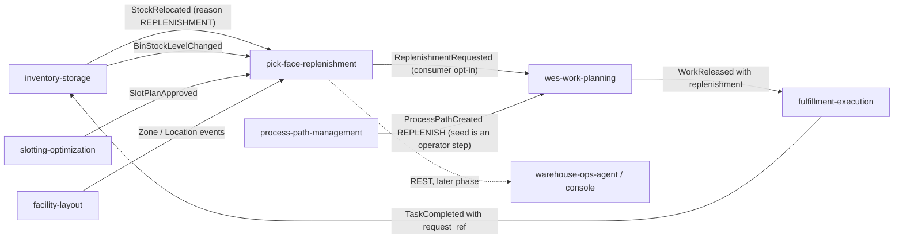

# Integration

Every upstream and downstream of `pick-face-replenishment`: protocol, contract and failure behaviour. Producer status was
checked against each sibling's `origin/develop` (`apis/asyncapi.yaml`, `apis/openapi.yaml`, code) on 2026-10-17.

**Fleet rules that shape this page.** The service makes **no outbound HTTP or MCP call** to any context: the module
imports `net/http` only for its own server, and cross-context data is event-fed local copies (ADR 0003). REST is
unauthenticated, and there is no MCP binary. Kafka is the single broker of the platform; every message is a CloudEvents
1.0 structured-mode event.

## Upstream and downstream edges

| Edge | Protocol | Contract | Status today |
| --- | --- | --- | --- |
| inventory-storage to this service | Kafka `warehouse.inventory.events` | `com.warehouse.wms.inventory-storage.stock.BinStockLevelChanged` | **built and published** (inventory-storage ADR 0040; producer change P1 of ADR 0003): absolute `on_hand` and `reserved` per `<bin>:<sku>` with a strictly increasing `version`, raised in the ledger's own transaction. The field names are the ones this service decodes. There is no backfill: a bin learns its first level at its next change. |
| inventory-storage to this service | Kafka `warehouse.inventory.events` | `com.warehouse.wms.inventory-storage.stock.StockRelocated` | **built and published**; its `reason` enum is `SLOTTING`, `CONSOLIDATION`, `MANUAL` and `REPLENISHMENT` (inventory-storage ADR 0041; producer change P4). `REPLENISHMENT`, the only reason that completes a request, is set only by a completed `REPLENISH` task, with `source_ref` = the task's `request_ref`; the same transaction also raises two `BinStockLevelChanged` events with reason `REPLENISHMENT` (source bin, then destination bin). |
| slotting-optimization to this service | Kafka `warehouse.slotting-optimization.events` | `com.warehouse.wms.slotting-optimization.slotplan.SlotPlanApproved` | **built and published**: `plan_id`, `site_id`, `approved_at`, the full `assignments[{sku, slot}]` map |
| facility-layout to this service | Kafka `warehouse.facility.events` | `...facility-layout.zone.ZoneRegistered`, `...locationslot.LocationSlotRegistered`, `...locationslot.LocationSlotDecommissioned` | **built and published** (`role` is absent on events from before it existed and means Storage) |
| this service to wes-work-planning | Kafka `warehouse.pick-face-replenishment.events` | `ReplenishmentRequested` | **built, opt-in** (P3b of ADR 0001; wes-work-planning ADR 0042): `internal/adapters/inbound/kafka/replenishment_consumer.go` plans one `REPLENISH` work unit per request id from `ReplenishmentRequested`. `ReplenishmentCancelled` withdraws the unit only while it is `Pending`; `ReplenishmentCompleted` is ignored. The consumer starts only with `REPLENISHMENT_MODE=kafka` and `REPLENISHMENT_CONSUMER_GROUP`; the default `permissive` consumes nothing. |
| process-path-management to wes-work-planning | Kafka `warehouse.process-path-management.events` (catalogue replay) | `ProcessPathCreated` for the `REPLENISH` path | **declared, seeding is an operator step** (process-path-management ADR 0036): `catalogue/paths.json` has `REPLENISH` with `matchPrefix` `replenish`, capability `replenish` and intake `REPLENISHMENT`, applied by `scripts/seed_catalogue.py`. Until it is seeded in a cluster, wes-work-planning dead-letters the requests (its ADR 0042). |
| wes-work-planning to fulfillment-execution | Kafka `warehouse.work-planning.events` | `WorkReleased` with a `replenishment` object | **built and published** (P3): wes-work-planning releases `WorkReleased` with the additive `replenishment` object (its ADR 0042), and fulfillment-execution creates a `REPLENISH` task from `WorkReleased.data.replenishment` (its ADR 0050) and announces it on `TaskAvailable`. |
| fulfillment-execution to inventory-storage | Kafka `warehouse.fulfillment.events` | `TaskCompleted` with `request_ref`, then `StockRelocated` with reason `REPLENISHMENT` | **built and published** (P4): fulfillment-execution publishes `TaskCompleted` with `request_ref` (its ADR 0050), inventory-storage applies it as a relocation with reason `REPLENISHMENT` (its ADR 0041). |
| this service to analytics | Kafka `warehouse.pick-face-replenishment.analytics` | the three request events plus `ReplenishmentPolicyDeclared` | no consumer in any repository checked |
| this service to warehouse-ops-agent, warehouse-console, agents | REST (Open Host Service) | `apis/openapi.yaml` | no client in any repository checked; "later phases" in ADR 0001. Not routed in `warehouse-infra` (no Kong route). |
| this service to any sibling over REST or MCP | none | none | banned by the fleet rule, and absent |

Consequence: the chain is **built end to end on `develop` but not live**. A request is raised here, planned as one
`REPLENISH` work unit by wes-work-planning, released with a `replenishment` object, run as a `REPLENISH` task by
fulfillment-execution, applied by inventory-storage as a relocation with reason `REPLENISHMENT`, and closed here by that
`StockRelocated`. It is not live: this service is not deployed (`warehouse-infra` has no `pick-face-replenishment` entry:
no helm values, route or database) and `warehouse-infra` sets no `REPLENISHMENT_MODE` for wes-work-planning, so that
consumer stays off by default. The `REPLENISH` path must also be seeded in process-path-management before requests can be
planned. Until a bin changes,
its level is unknown and detection reports `NO_SOURCE` (inventory-storage has no backfill); the sweep endpoint and the
pick-face view report this state instead of failing.

Source: `internal/adapters/inbound/kafka/*_consumer.go`, `apis/asyncapi.yaml`, ADR 0001 context map, and each sibling's
`apis/asyncapi.yaml` and ADRs on `origin/develop`. Solid arrows exist as producer and consumer; the dotted arrow lacks a
caller. Solid does not mean live: this service is not deployed and `warehouse-infra` sets no `REPLENISHMENT_MODE`.

### Status since the ADRs

ADRs are immutable, so their statements keep their date. Read these against `origin/develop` of the siblings:

| ADR statement | Status now |
| --- | --- |
| ADR 0001: `BinStockLevelChanged` producer change P1 is planned | built: inventory-storage ADR 0040 |
| ADR 0001: P4 (`TaskCompleted` of a `REPLENISH` task becomes a relocation with reason `REPLENISHMENT`) is planned, not built | built: fulfillment-execution ADR 0050 publishes `TaskCompleted` with `request_ref`, inventory-storage ADR 0041 applies it |
| ADR 0001: P3 (`WorkReleased` with a `replenishment` object creates a `REPLENISH` task) is planned, not built | built on both sides: wes-work-planning releases the object (its ADR 0042), fulfillment-execution creates the task (its ADR 0050) |
| ADR 0001: P3b (wes-work-planning turns `ReplenishmentRequested` into `REPLENISH` work) is planned, not built | built, opt-in: wes-work-planning ADR 0042 (`replenishment_consumer.go`, started with `REPLENISHMENT_MODE=kafka`); the `REPLENISH` path is declared in process-path-management ADR 0036 and still has to be seeded per cluster. Not deployed: `warehouse-infra` sets no `REPLENISHMENT_MODE` |
| ADR 0003: `BinStockLevelChanged` is a pending producer change; until P1 ships `bin_stock_levels` stays empty | shipped; no backfill, so a bin is learned at its next change |
| ADR 0003: until P4 ships no relocation carries `REPLENISHMENT` | shipped (inventory-storage ADR 0041) |
| ADR 0003: slotting-optimization's relocation consumer does not filter on `reason` | it acts only on reason `SLOTTING` and counts other reasons as unmatched (`internal/application/usecases/record_relocation.go`) |

## Consumed contracts in detail

All consumers decode CloudEvents only, dispatch on the full `type`, ignore other types, and run each message in one
database transaction with the `processed_events` claim (see the [Runbook](/docs/operations/runbook#delivery-semantics-of-the-consumers)).

| Type | Fields read | Effect | Failure behaviour |
| --- | --- | --- | --- |
| `BinStockLevelChanged` | `site_code`, `bin`, `sku`, `on_hand`, `reserved`, `version` (`reason`, `occurred_at` ignored) | upsert `bin_stock_levels` only when `version` is greater than the stored one, then evaluate the SKU's pick face | blank ids, negative levels or `version` below 1: dead-lettered at once |
| `StockRelocated` | `relocation_id`, `site_code`, `sku`, `from_bin`, `to_bin`, `quantity`, `reason`, `source_ref` | complete the open request named by `source_ref` when reason is `REPLENISHMENT` and site, SKU and both bins match | anything else is ignored; a `REPLENISHMENT` relocation whose `source_ref` has the shape of a request id and whose quantity is below 1 is dead-lettered |
| `SlotPlanApproved` | `plan_id`, `site_id`, `approved_at`, `assignments[{sku, slot}]` (`moves`, `supersedes_plan_id` ignored) | replace the site's forward map, cancel requests whose bin no longer holds their SKU, evaluate new or moved faces | older or equal `approved_at`: `stale`, ignored; blank fields or a SKU assigned twice: dead-lettered |
| `ZoneRegistered` | `zoneId`, `siteCode`, `zoneCode` | upsert `zones` | blank field: dead-lettered |
| `LocationSlotRegistered` | `locationCode`, `zoneId`, `role` | upsert `locations` (a decommissioned location stays decommissioned) | blank field: dead-lettered |
| `LocationSlotDecommissioned` | `locationCode` | mark the location decommissioned, also if never seen | blank code: dead-lettered |

A location and its zone may arrive in any order; they are joined when read. A bin whose location is unknown counts as a
pick face (permissive until the layout converges), but never as a reserve bin.

Consumer-first note: this service pinned `BinStockLevelChanged` and the `REPLENISHMENT` reason before the producers
shipped them (ADR 0003). Both have shipped, and the fields this service reads match inventory-storage's
`apis/asyncapi.yaml` (`BinStockLevelChangedEvent`, `StockRelocatedEvent`) on `origin/develop`, so no follow-up change
here was needed.

## Published contract

Four types on two topics, listed on the [Event catalogue](/docs/api-reference/events). Failure behaviour of the
publisher: the events are written to `outbox_events` in the business transaction, so a broker outage never fails a REST
call or a consumer message; the relay retries, keeps order and caps a poisoned row after `OUTBOX_MAX_ATTEMPTS`
([Runbook](/docs/operations/runbook#outbox-relay)). A downstream sees at-least-once delivery with a stable CloudEvents
`id`.

`ReplenishmentRequested` is the only event that asks the floor to do something. `ReplenishmentCancelled` tells a
downstream to drop work it has not released: wes-work-planning withdraws its `REPLENISH` unit only while it is `Pending`
(its ADR 0042), and a request already released as floor work runs to completion; this service does not recall it.

## REST surface

`apis/openapi.yaml` (12 operations) is the synchronous contract for planners, the console and agents
([API reference](/docs/api-reference)). It is declared on `http://localhost:8080` and, for the kind cluster, as
`http://localhost:8000/api/pick-face-replenishment` through Kong; `warehouse-infra` has no route or values file for it yet.
