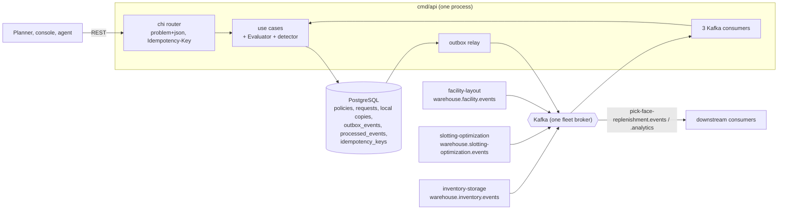

# Architecture

The module is `github.com/claudioed/pick-face-replenishment` (Go 1.27.2 per `go.mod`). It is hexagonal:
dependencies point inward, and `internal/architecture` fails CI when they do not.

## Layout

| Path | Role |
| --- | --- |
| `internal/domain/policy` | `ReplenishmentPolicy`: versioned min/max/multiple value object, `RoundDown`, the `Declaration` fact |
| `internal/domain/replenishment` | `ReplenishmentRequest` aggregate (`Plan`, `Complete`, `Cancel`, `Restore`), states, priorities, cancel reasons, domain events |
| `internal/domain/detection` | the pure `Detect` function and the `SourceBinPolicy` port (`fullest-reserve-bin-v1`) |
| `internal/domain/shared` | the ECMA-262 blank-string rule shared by the contract's `pattern: '\S'` |
| `internal/application/usecases` | one type per use case plus the shared `Evaluator` and the `Intake` claim-and-apply skeleton |
| `internal/application/ports`, `repository`, `outbox` | out ports, their error and value vocabulary, the outbox message type |
| `internal/adapters/inbound/http` | chi router, handlers, RFC 7807 problems, `Idempotency-Key` middleware, `/healthz` and `/readyz` |
| `internal/adapters/inbound/kafka` | the consume loop, dead-lettering and the inventory, slotting and layout consumers |
| `internal/adapters/outbound/postgres` | pgx repositories, unit of work, outbox repository, embedded migration runner |
| `internal/adapters/outbound/events` | maps domain facts to CloudEvents outbox messages |
| `internal/adapters/outbound/outbox` | the relay loop that drains `outbox_events` |
| `internal/adapters/outbound/kafka` | the acks=all Kafka writer used by the relay |
| `internal/adapters/outbound/memory` | in-memory test doubles for the unit and BDD suites only; the shipped binary never imports them (ADR 0006) |
| `internal/adapters/kafka/cloudevents` | the single home of the CloudEvents 1.0 envelope (`New`, `Decode`) |
| `internal/bootretry` | start-up retry with exponential backoff for the first outbound dial |
| `migrations/` | embedded golang-migrate SQL (`0001_replenishment_schema`, `0002_forward_assignment_maps`) |

## Binaries

| Binary | Role | Ports |
| --- | --- | --- |
| `cmd/api` | Composition root. Serves REST, runs the outbox relay and the three Kafka consumers, all always on, on real Postgres and Kafka (ADR 0006). | HTTP `:8080` (`HTTP_ADDR`) |
| `cmd/mcp` | Read-only MCP server over Streamable HTTP (ADR 0007): `list_policies`, `get_policy`, `list_pick_faces`, `list_replenishments`, `get_replenishment`, over the same read use cases as REST. Builds no outbox, unit of work or event sink; never dials Kafka. | `:8090` (`MCP_ADDR`), `/mcp`, `/healthz` |
| `cmd/pfr-projector` | The only writer of the analytical database (ADR 0008): consumes `warehouse.pick-face-replenishment.analytics` and folds it into fact tables; dead-letters deterministic poison; exits non-zero if its consumer loop stops. | admin `:8091` (`ADMIN_ADDR`): `/healthz`, `/readyz` |
| `cmd/pfr-reports` | Read-only reports over the analytical database through a read-only pool: `GET /reports/replenishment-funnel`, `GET /reports/freshness`. | HTTP `:8092` (`HTTP_ADDR`) |

`web/` is the operator Module Federation remote `replenishment_mfe` (policies, pick faces, replenishments); it calls only
`/api/pick-face-replenishment`. The three background loops are goroutines of `cmd/api`, not
separate deployables, so one process owns the HTTP server, the relay and the consumers and shuts them down in order
([Runbook](/docs/operations/runbook#readiness-and-shutdown)).

## Containers and components

Source: `cmd/api/main.go`, `cmd/api/adapters.go`, `cmd/api/consumers.go`, `cmd/api/relay.go`,
`internal/adapters/inbound/http/server.go`.

## Wiring

`cmd/api/adapters.go` builds the adapters: it runs the embedded migrations (against
`MIGRATIONS_DATABASE_URL` when set), opens a pgx pool and wires the Postgres repositories, the outbox repository and the
`Idempotency-Key` middleware. `DATABASE_URL` is mandatory ([ADR 0006](/docs/adr/0006-postgres-and-kafka-are-the-only-runtime)):
there is no in-memory mode and the `memory` package is a test double only. Use cases are built once and shared: the HTTP handlers, the consumers and the sweep all go through the same
`Evaluator`, so they cannot disagree about when a request is raised.

Every write runs in one `UnitOfWork`: load, apply the aggregate command, save guarded by the loaded version, and hand
the raised facts to the outbox in the same transaction. The consumers add the `processed_events` claim to that
transaction.

## Data stores

| Store | What lives there |
| --- | --- |
| PostgreSQL | `policies`, `replenishment_requests` (aggregate state), the local copies `bin_stock_levels`, `forward_assignments`, `forward_assignment_maps`, `zones`, `locations`, and the plumbing `outbox_events`, `processed_events`, `idempotency_keys`. Diagram: [Entity-relationship](/docs/ddd/entity-relationship). |
| Kafka | the integration and analytics topics this service writes and the three topics it reads ([Runbook](/docs/operations/runbook#kafka-topics-and-consumer-groups)) |
| Memory | development mode only; lost on restart |

## Fitness tests that guard the layout

`TestHexagonalArchitecture` (domain imports only domain, application only domain and application, inbound and outbound
adapters do not import each other, only `cmd` wires layers), `TestCloudEventsOnly`,
`TestKafkaConsumerGroupNeverHardcodedInline`, `TestKafkaWritersSetRequiredAcks`, `TestOutboxRelaysPassAttemptCap`,
`TestNoAuthMiddlewareReintroduced`, `TestEventCatalogueMatchesContract`. The full list is on
[Testing](/docs/development/testing#architecture-fitness-tests).
